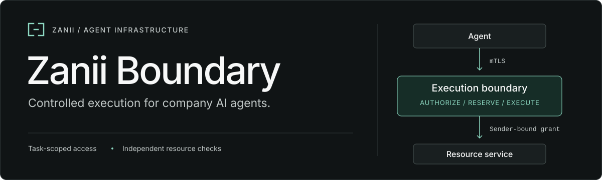
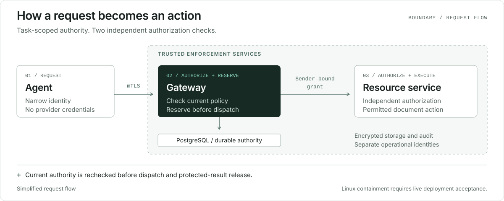

<p align="center">
  
</p>

# Zanii Boundary

A document-action gateway that gives AI agents narrow, task-scoped access to company resources—without handing them provider or administrative credentials.

Boundary checks the tenant, task, document, recipient, purpose, approval and expiry of each action. It records durable operation state before dispatch, while the resource service independently authorizes the request. Prompts, document contents and model output never grant permission.

**Status: local verification; not cleared for production.** Linux host containment, live provider policies, customer workloads and operational acceptance remain open. See the [readiness report](docs/product-readiness-report.md) before deployment.

[Architecture](docs/product-architecture.md) · [API](docs/product-api.md) · [Deployment](deploy/distributed/README.md) · [Readiness](docs/product-readiness-report.md) · [Operations](docs/product-operations.md)

## What it does

| Area | Implementation |
| --- | --- |
| Task-scoped authorization | Tenant and actor isolation, document permissions, purpose and recipient restrictions, exact approvals, expiry and shared ancestor quotas. Child tasks can only narrow authority. |
| Controlled execution | Mutual TLS, sender-bound grants, durable operation reservations, fenced leases and current-policy checks before dispatch and result release. |
| Storage and recovery | Shared PostgreSQL authority, encrypted document storage, independent signed audit archives, resumable backups and quarantined restore. SQLite is available for local tests. |
| Agent integrations | A JavaScript client, Python SDK, REST/document adapter, MCP and A2A adapters, and configured Zanii Runtime/broker integrations. |
| Reviewed learning | Bounded content detection, quarantine, signed promotion and rollback. Document text and learned signals cannot expand permissions. |
| Operations | Structured logs, metrics, OpenTelemetry tracing, maintenance workers and explicit deployment acceptance gates. |

The first supported workflow is an internal document service. **Sharing writes to an internal mailbox; it does not send external email.** Other company systems need trusted adapters and provider-side enforcement. Industry profiles are policy starting points, not certifications.

## Request flow

<p align="center">
  
</p>

1. The agent submits an action using a narrow identity and an owner-issued task.
2. The gateway authenticates the caller and checks current policy, coverage and required integrations.
3. Boundary reserves the operation and its quota or approval, then rechecks authority before dispatch.
4. The resource service validates the grant independently and performs the permitted action.
5. Boundary records the outcome and checks current authority again before releasing protected content.

Retries use the operation ID to identify existing work. Ambiguous external outcomes are reconciled rather than blindly dispatched again. The [architecture and threat model](docs/product-architecture.md) describe the trust assumptions and failure handling.

## Local setup

Use **Node.js 24.19.0** and **Python 3.12**. Run these commands from the repository root:

```sh
npm ci --ignore-scripts --no-audit --no-fund
python -m pip install --only-binary=:all: --require-hashes -r requirements-ci.txt
python scripts/test-pki.py --flat --output artifacts
npm test
npm run product:check
npm run product:lint
npm run product:typecheck
python -m unittest discover -s sdk/python -p 'test_*.py'
```

Dependencies are pinned in `package-lock.json`; the Python lock pins `cryptography==50.0.0` for synthetic test identities. Keep generated certificates, keys, databases and scanner output private. The PKI command creates test identities, not deployment credentials.

The default Node tests use real loopback TLS and local disk/SQL fixtures, with file isolation disabled. These checks do **not** establish agent operating-system containment or independent PostgreSQL wire/HA acceptance.

Additional acceptance checks:

```sh
npm run test:isolated
npm run product:socket-acceptance
node scripts/distributed-acceptance.mjs --static
node scripts/monitoring-acceptance.mjs --static
```

Missing prerequisites produce nonzero `BLOCKED` results. Static checks retain `liveVerified: false`; they are not substitutes for a deployed acceptance run. See [local and deployment evidence](docs/product-readiness-report.md).

## Client example

The package is named `@zanii/boundary` and is marked private in this repository. This example uses its package export from within a configured workspace; it is not a standalone quickstart. A running gateway, explicit identity material, an owner-issued task and a permitted document are required.

```js
import { createFileProductClient } from '@zanii/boundary';

const client = createFileProductClient({
  origin: 'https://gateway',
  socketPath: '/run/runtime/gateway.sock',
  caFile: '/run/identity/ca.pem',
  certFile: '/run/identity/agent-cert.pem',
  keyFile: '/run/identity/agent-key.pem',
  tokenFile: '/run/identity/agent.jwt',
});

const result = await client.execute('task-id', {
  id: 'operation-id',
  kind: 'read',
  documentId: 'policy',
});
```

The root and `./client` exports expose the product client; `./evidence` exposes audit verification. Historical experiment clients are explicitly separated under `./research/client` and `./research/evidence`. See the [API reference](docs/product-api.md) and [adapter contracts](docs/adapter-ports.md).

## Deployment and limits

The supported deployment target is Linux Docker/Compose with separate application, worker, archive, backup, rotator and migrator identities. The distributed profile uses rootful user-namespace remapping, an agent without networking, a fixed byte relay, scoped provider egress and shared PostgreSQL. Configuration templates alone do not prove those controls are active.

- **Deployment acceptance is open.** A staging host, live provider policies, customer workloads, genuine cost inputs and named operational owners are still required. Follow the [deployment guide](deploy/distributed/README.md), [acceptance gates](docs/product-readiness-report.md#acceptance-gates) and [operations guide](docs/product-operations.md).
- **The Runtime-enabled performance objective remains unmet.** The 5 requests/second warmup reached grant expiry before the 10 requests/second sustained cohort. Guards prevented expired dispatch; a separate lower-rate run completed correct effects but exceeded the unchanged median-latency target. Canonical evaluation/load remain core-only. See [performance limits](docs/product-readiness-report.md#performance-limits).
- **Upstream Runtime is a bounded preflight, not the enforcement boundary.** Runtime `0.4.0` uses its separately pinned SDK `0.6.0`; the broker path retains SDK `0.5.4`. Configured paths require accepted receipts and final authority checks. See [integration boundaries](docs/product-architecture.md#runtime-and-protocol-integrations).
- **Security evidence has a defined scope.** Recorded npm auditing found four moderate affected dependency entries from one minimatch advisory and no high/critical entries. A manual Trivy filesystem observation found the same medium advisory and a low mixed-role healthcheck observation. Neither establishes a scanned built image, CodeQL execution, hosted CI or deployed security. See [recorded security observations](docs/product-readiness-report.md#recorded-security-observations).

Boundary does not offer universal protection for arbitrary agents, unrestricted tools or undiscovered resource routes. Signed evidence authenticates statements under pinned trust keys; it does not establish evaluator honesty or production containment.

## Documentation

| Start here | Reference |
| --- | --- |
| Design and trust | [Architecture and threat model](docs/product-architecture.md) |
| Interfaces | [Product API](docs/product-api.md), [adapter ports](docs/adapter-ports.md) |
| Operations | [Operator guide](docs/product-operations.md), [monitoring runbook](docs/monitoring-runbook.md) |
| Evaluation | [Capacity measurement](docs/capacity-measurement.md), [capacity and cost](docs/capacity-cost.md), [readiness](docs/product-readiness-report.md) |
| Research | [White-paper draft](paper/white-paper.md), [historical milestones](archive/) |

Historical milestones are retained for reproducibility and do not evaluate the current product. The white paper is an engineering draft, not a published or independently reproduced result. No first-invention, patentability or superiority claim is established.

## Credits

Created by **Louis Chifura** (`@vigilancetrent`) and **zaniiai**. The white-paper draft retains its existing author attribution, **zinii ai**.
