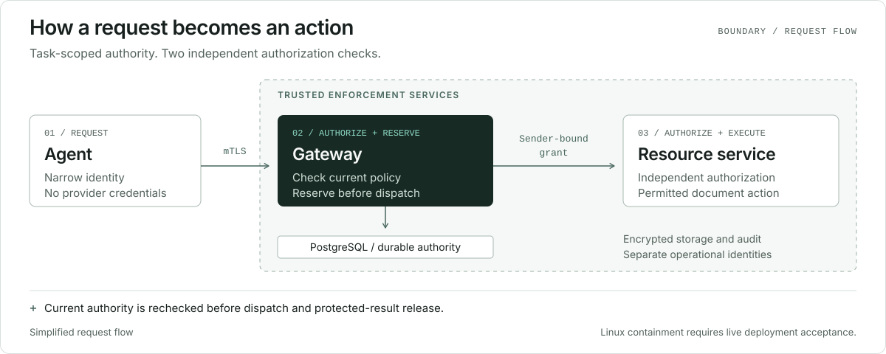

# Architecture

Boundary controls a declared document workflow across three roles: an untrusted agent, a trusted gateway and an independently authorizing resource service. Prompts, document text, model output, memory and learning feedback are not sources of authority.

## Authorization and execution

An action binds tenant, actor, task, document, recipient, purpose, arguments, provider revision and deadline. Child tasks narrow authority and share ancestor quotas. The gateway reserves the operation, quota and any required approval before external effects. A reused operation ID with conflicting arguments is rejected.

The gateway checks current policy before dispatch and again before releasing protected results, including cached results. A resource service verifies sender-bound grants independently. Fenced leases limit competing owners; unknown external outcomes require observation and reconciliation, not blind replay.

Implementation: `src/product/server.mjs`, `policy.mjs`, `executor.mjs` and `transport.mjs`; resource behavior lives in `src/adapters/documents.mjs`. See the [API](product-api.md).

## Storage and recovery

The asynchronous store interface supports SQLite for local use and PostgreSQL for shared authority. PostgreSQL uses checksum-bound migrations, row-level security, dedicated roles, tenant transactions and bounded connection/query deadlines. Local PGlite tests do not establish independent PostgreSQL wire sessions or high availability.

Encrypted records and objects bind tenant, version and identifier through authenticated associated data. External effects occur outside database transactions. Audit archive and backup identities are separate from application decryption authority; signed immutable segments and retained checkpoints support verification.

Backups use bounded per-tenant encrypted logical snapshots and resumable encrypted spools. The initial snapshot ceiling is 64 MiB per tenant, not an unlimited cluster backup. Restore targets a new empty realm and stays quarantined until source fencing and privacy reconciliation are accepted. Retention does not protect against key loss; custody remains an operator responsibility.

## Runtime and protocol integrations

The installed upstream Runtime `0.4.0` performs a bounded, fixed, reversible authorization preflight. Its nested SDK `0.6.0` is separate from the broker path's SDK `0.5.4`. Accepted receipts and fresh authority checks remain required on the configured path; Runtime does not replace Boundary's durable enforcement or admit arbitrary company tools.

MCP and A2A adapters expose configured document operations. Register, Passport and Vault companion integrations require their own accepted identities and endpoints. Integration details and trust boundaries are in [adapter ports](adapter-ports.md).

## Threat model

Trusted components include owner/approver identities, task policy, gateway code, resource authorization, provider admission controls, key custody and independent evidence evaluators. A stolen unrestricted provider credential, privileged host compromise or undiscovered alternate resource route can bypass a gateway-only guarantee.

Content detection is bounded and advisory. Quarantine and signed, reviewed promotion must not expand execution authority. General, finance, healthcare and industrial profiles are policy starting points, not compliance, clinical or physical-safety certifications.

Signatures authenticate statements and consistency under pinned keys. They do not prove evaluator honesty, external time, complete route discovery, blockchain anchoring or production containment.

## Deployment boundary

The target is Linux Docker/Compose with separate application, worker, archive, backup, rotator and migrator identities. The distributed profile uses rootful user-namespace remapping, no agent networking, a fixed opaque byte relay, scoped provider egress and shared PostgreSQL.

The relay preserves end-to-end TLS identity and does not retry mutations. Templates and static validation are not proof of live UID mappings, filesystem isolation, network closure or provider IAM. Read [deployment](../deploy/distributed/README.md), [operations](product-operations.md) and [readiness](product-readiness-report.md) before admission.
